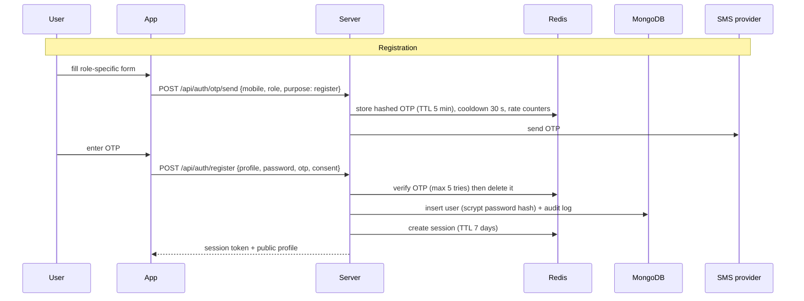
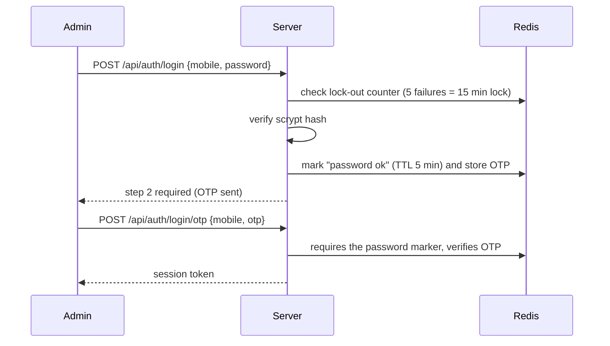

# Accounts, Login and Data Storage

How users sign in to the five portals and where every piece of data and every log line is stored.

## 1. Portals and what each account needs
| Portal | Registration (mobile and password always required) | Login |
|---|---|---|
| **Farmer** | full name, state, district, PIN code, village (optional), land size (optional), main crops (optional) | mobile + password, or mobile + OTP |
| **Bulk buyer** | contact name, business name, business type, designation, address, city, state, PIN code, GSTIN (optional, format-checked), business email (optional) | mobile + password, or mobile + OTP |
| **Household** | full name, delivery address, city, state, PIN code | mobile + password, or mobile + OTP |
| **Delivery partner** | full name, vehicle type, vehicle number (format-checked), driving licence number, city / operating area, state | mobile + password, or mobile + OTP |
| **Operations (admin)** | no self-registration: created from `ADMIN_MOBILE` / `ADMIN_PASSWORD` on server start | mobile + password **then** OTP (two steps, always) |

Every registration also needs: a mobile number verified by OTP, a password (8+ characters, letters and numbers; 10+ for admin), and consent to the Terms and Privacy Policy (version and time are stored). A mobile number can hold one account per portal.
New farmers and bulk buyers start as **"In review"** and appear in *Admin -> Verification*; they can use the app fully once an admin approves them.

## 2. Flows


Other endpoints: `POST /api/auth/login` (password), `POST /api/auth/login/otp`, `POST /api/auth/password/reset`, `GET /api/auth/me`, `POST /api/auth/logout`, `POST /api/auth/profile`, and admin-only `GET /api/admin/logs`, `GET /api/admin/users`, `POST /api/admin/users/status` (block / unblock).

## 3. Where data lives
| Data | Store | Details |
|---|---|---|
| Users and profiles | **MongoDB** `users` | unique index (`mobile`, `role`); password stored only as `scrypt$salt$hash`; consent record; status `active` / `blocked`; `lastLoginAt` |
| Shared marketplace dataset (farmers, buyers, listings, orders, scans, drivers ...) | **MongoDB** `app_state` | one document `{_id:'main', rev, state, savedAt}`; login required to read or write; writes are logged |
| Audit and security logs | **MongoDB** `logs` | TTL index deletes entries after 180 days; index on (`event`, `ts`) |
| Recent log tail (admin screen) | **Redis** list `logs:recent` | capped at 500 entries |
| OTPs | **Redis** `otp:<purpose>:<role>:<mobile>` | SHA-256 hash with secret pepper, TTL 5 min, attempt counter |
| OTP cooldown / hourly limits | **Redis** `otpcd:*`, `rl:otp-mobile:*`, `rl:otp-ip:*` | 30 s cooldown, 5 per mobile per hour, 20 per IP per hour |
| Login sessions | **Redis** `sess:<sha256(token)>` | TTL 7 days (`SESSION_DAYS`); the raw token is never stored |
| Login lock-out | **Redis** `lf:<role>:<mobile>` | 5 failures = 15 minutes |
| Rate limits for AI and translate | **Redis** `rl:ai:<ip>` | 60 requests per minute per IP |
| Mandi price cache, translation cache | files in `data/` | `mandi.json`, `translations.json` (re-creatable) |

**Without `MONGODB_URI` / `REDIS_URL`** the same code runs on a local file (`data/dev-db.json`) and in-memory maps. That is for development and tests only: sessions and OTPs are lost on restart and nothing is shared between servers.

### Log entry shape
```json
{ "ts": "2026-10-19T08:15:02Z", "level": "info|warn|error", "event": "login.success", "userId": "u_ab12...", "role": "farmer", "ip": "203.0.113.7", "meta": { "method": "password" } }
```
Events: `otp.sent`, `otp.wrong`, `otp.rate_limited`, `otp.send_failed`, `user.registered`, `login.success`, `login.failed`, `login.locked`, `logout`, `password.reset`, `profile.updated`, `state.write`, `admin.user_status`, `admin.bootstrapped`. Passwords, OTPs and tokens are never written to logs. Logs are also printed to stdout as JSON lines (disable with `LOG_STDOUT=0`) so a log shipper can collect them.

## 4. Setup
```bash
docker compose up -d mongo redis          # or use MongoDB Atlas / managed Redis
cp .env.example .env                      # fill MONGODB_URI, REDIS_URL, SMS_*, ADMIN_*, OTP_SECRET
npm install && npm run build
npm run db:check                          # verifies both databases (write, read, TTL, counters)
npm start
```
`.env` example for local Docker databases:
```
MONGODB_URI=mongodb://localhost:27017
REDIS_URL=redis://localhost:6379
SMS_PROVIDER=fast2sms            # see below
SMS_API_KEY=...
OTP_SECRET=<64 random hex chars>
ADMIN_MOBILE=9XXXXXXXXX
ADMIN_PASSWORD=<10+ chars, letters and numbers>
```
### SMS providers (OTP delivery)
| `SMS_PROVIDER` | Needs | Notes |
|---|---|---|
| `console` | nothing | development only: OTP printed in the server log and shown on screen. The server **refuses to start** with this provider when `NODE_ENV=production`. |
| `fast2sms` | `SMS_API_KEY` | OTP route; check your DLT / route approvals |
| `msg91` | `SMS_API_KEY`, `MSG91_TEMPLATE_ID` | needs an approved DLT template |
| `twilio` | `TWILIO_SID`, `TWILIO_TOKEN`, `TWILIO_FROM` | |
Indian SMS rules (DLT registration of sender and template) apply to every provider.

## 5. Production checklist
- [ ] `NODE_ENV=production`, a real `SMS_PROVIDER`, long random `OTP_SECRET`, HTTPS in front of the server, `TRUST_PROXY=1` behind a proxy.
- [ ] MongoDB with authentication, TLS and daily backups; Redis with a password / private network and persistence (the compose file enables append-only).
- [ ] Restrict CORS and the Sarvam widget key to your domain; rotate any key that was shared.
- [ ] Remove starter records (*Admin -> Data management*), then review users and logs regularly.
- [ ] Complete the items still open in [SECURITY.md](SECURITY.md) (per-role authorisation on dataset records, record-level storage).
