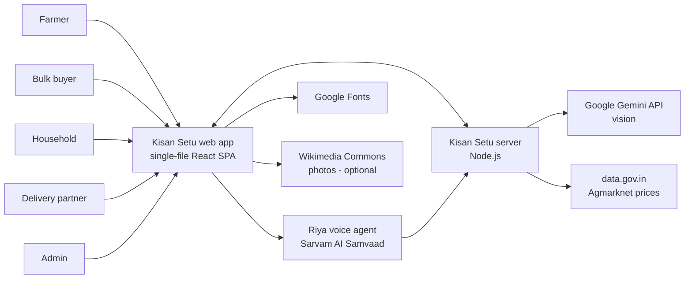
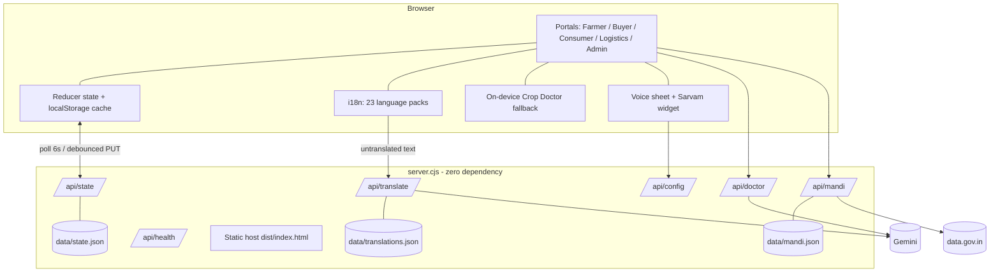
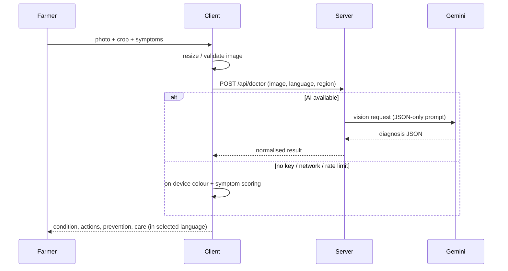
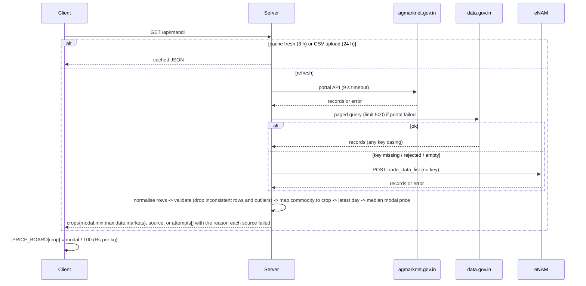
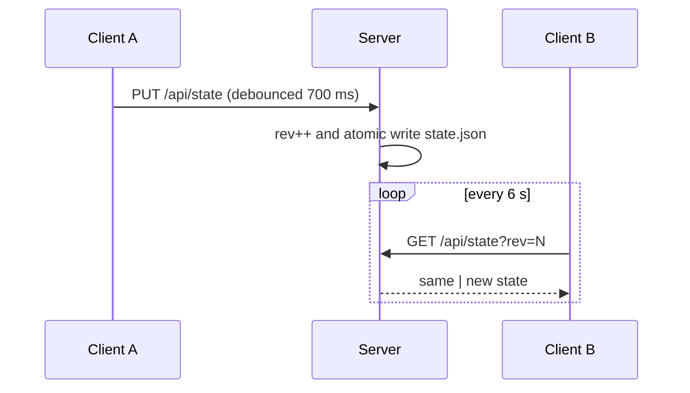
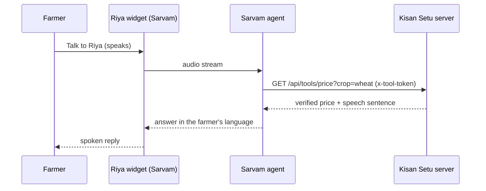
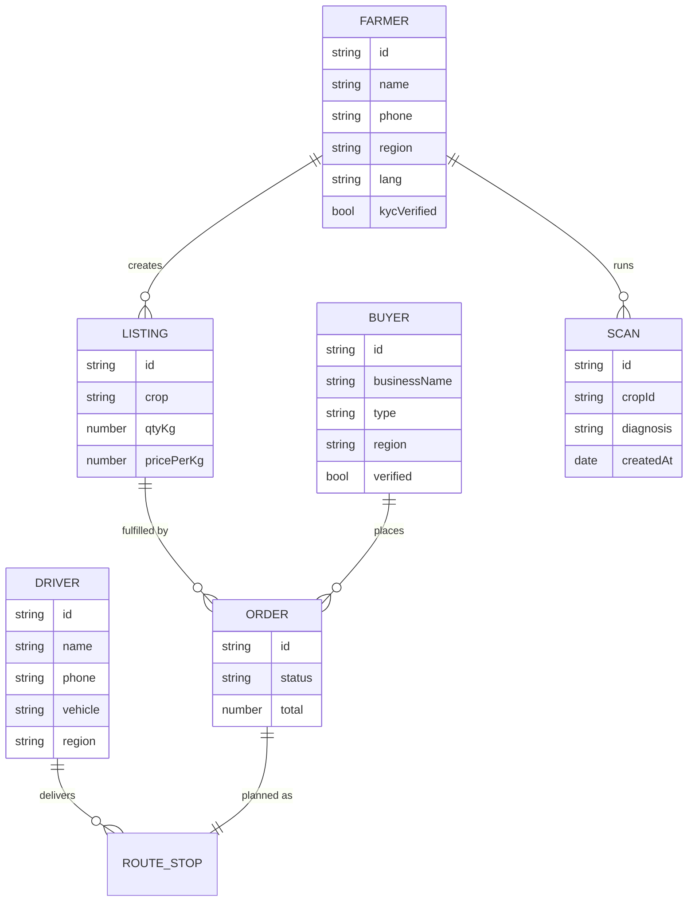
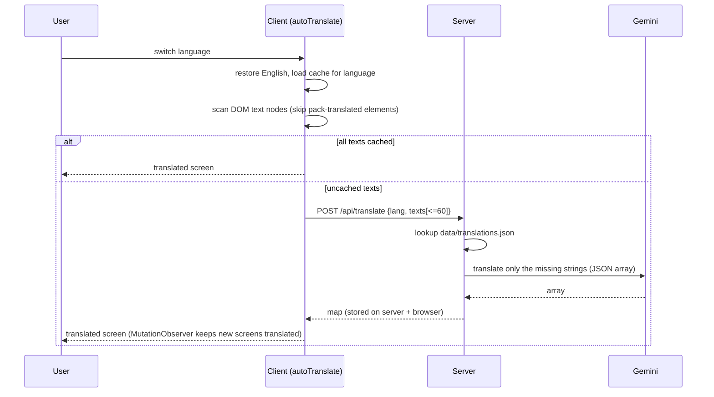
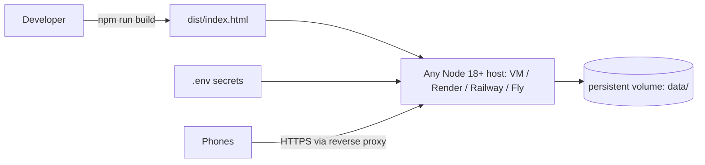

# Technical Design Document - Kisan Setu (India edition)

Version 8.0 · Status: pilot-ready, pre-production · Diagrams use [Mermaid](https://mermaid.js.org) (render natively on GitHub/GitLab/VS Code).

## 1. Purpose and scope
Kisan Setu connects India farmers directly with bulk buyers, households and delivery partners, and gives farmers AI crop diagnosis, live mandi prices and a voice assistant in their own language. This document describes the architecture, data, integrations, security and quality approach.

**Goals:** simple mobile-first UI in 23 languages; real data in/out (CSV import, shared store, live prices); graceful degradation when any external service is down.
**Non-goals (this release):** payments settlement, OTP identity, multi-tenant authorization, native apps.

## 2. System context

## 3. Architecture

**Build:** `build.cjs` bundles `src/js/*.jsx` (ordered by filename) with esbuild, inlines CSS and any images in `assets/`, and emits one `dist/index.html`. React, no router library; roles are switched by `session.role`.

| Layer | Files | Notes |
|---|---|---|
| Foundation | `01a_head`, `01b_logic`, `01c_i18n_ext` | constants, languages, reducer, persistence + sync |
| UI kit & art | `02a_art`, `02b_ui` | icons, crop illustrations, shared components |
| Portals | `03_landing`, `05*_farmer`, `06_buyer_consumer`, `06z_account`, `07_logistics`, `08_admin` | one file per portal |
| Crop Doctor | `04a_doctor_data`, `04b_doctor`, `04c_doctor_engine` | UI, data, Gemini client + offline engine |
| India data | `00_india` | states, MSP, live price hook, Sarvam component |

## 4. Key flows
### 4.1 Crop Doctor

### 4.2 Live mandi prices (multi-source, validated)

Fallback of last resort: admin uploads a CSV (`POST /api/mandi/import`), which needs no external service.

### 4.3 Shared data sync

### 4.4 Voice assistant (Riya)

Farmer home -> mic button -> `VoiceSheet`. If the server returns Sarvam config (`/api/config`) the widget script loads and a **Talk to Riya** voice session starts; otherwise a shortcut-command menu (Sell, Prices, Crop Doctor, Orders) is shown.

### 4.5 Accounts and sessions
Every portal uses the same `AuthScreen`: mobile + password or OTP, role-specific registration, forgot-password, and (for Operations) password followed by OTP. On success the server returns a session token; the app then loads the shared dataset **before** creating the user's profile so it never overwrites other users' data, and saves the profile immediately. Full flows, data stores and Redis keys: [AUTH_AND_DATA.md](AUTH_AND_DATA.md).

## 5. Data model

Persistence: MongoDB (`users`, `app_state`, `logs`) and Redis (OTP, sessions, rate limits) plus a localStorage cache per client; a local file and memory are used only when the URIs are not set. Collections: farmers, buyers, industrialBuyers, drivers, listings, orders, scans, residueListings, fraudFlags, audit log.

## 6. API reference
| Method | Path | Purpose | Errors |
|---|---|---|---|
| POST | `/api/auth/otp/send`, `/api/auth/register`, `/api/auth/login`, `/api/auth/login/otp`, `/api/auth/password/reset`, `/api/auth/logout`, `/api/auth/profile`; GET `/api/auth/me` | accounts for all portals (see AUTH_AND_DATA.md) | 400, 401, 409, 422, 429 |
| GET / POST | `/api/admin/logs`, `/api/admin/users`, `/api/admin/users/status` | operations tools (admin only) | 403 |
| GET | `/api/health` | status, `aiConfigured`, `mandiConfigured`, `rev` | - |
| POST | `/api/doctor` | AI diagnosis (JSON body: image data URL, lang, region, cropHint) | 400 bad image, 413 too large, 429 rate limit, 503 no key / upstream |
| GET | `/api/mandi[?refresh=1]` | live prices, `source`, or `{ok:false, reason, attempts[]}` | never 5xx (degrades) |
| POST | `/api/mandi/import` | admin CSV rows -> prices | 400 if no usable rows |
| GET / PUT | `/api/state` | shared dataset (login required); `?rev=` for conditional pull | 400, 401 |
| POST | `/api/translate` | batch-translate UI strings (`{lang, texts[]}` -> `{map}`), cached server-side | 400 bad language |
| GET | `/api/tools/price?crop=&state=` | speakable verified price for the Riya voice agent (`x-tool-token` if `VOICE_TOOL_TOKEN` set) | 401 |
| GET | `/api/config` | public widget config (`sarvam` or `null`) | - |

## 6a. Internationalisation
Three layers: (1) curated packs (`i18n/*.txt`: 106 UI strings + 98 Crop Doctor/guide strings, 19 languages plus built-in en/hi/mr/pa), (2) **auto-translate**, (3) fallback Hindi -> English. RTL for ur/ks/sd; fonts Noto Sans + script variants.

Design notes: text nodes are edited in place (never replaced) so React reconciliation is unaffected; elements carrying `data-lang` (pack strings) and `translate="no"` are skipped; numbers, URLs and brand names are preserved by the prompt; failures are remembered per session so there is no retry storm.

## 7. Non-functional requirements
| Area | Target / approach |
|---|---|
| Performance | single 1.2 MB file, no runtime framework fetch; API calls under 1 request/6 s/client |
| Availability | every external dependency has a fallback (AI -> on-device, prices -> reference, voice -> shortcuts, photos -> illustrations) |
| Usability | mobile-first, light theme, WCAG-style contrast, large tap targets |
| Maintainability | zero-dependency server, one file per feature area, generated i18n |
| Demonstration | `npm run demo` (Playwright) records screenshots and video of the end-to-end story |
| Observability | server logs per request; `/api/health` |

## 8. Deployment

Run behind HTTPS (Caddy/Nginx/Cloudflare). Mount `DATA_DIR` on a persistent volume and back it up daily.

## 9. Security and risk register
| # | Risk | Impact | Mitigation now | Next step |
|---|---|---|---|---|
| 1 | Any logged-in user can read the whole shared dataset | High | login required, hashed credentials, lock-outs, rate limits, audit log | per-record authorisation and record-level collections |
| 2 | Last-write-wins sync loses concurrent edits | Medium | 700 ms debounce, 6 s poll | per-collection patch API or SQLite/Postgres |
| 3 | Sarvam key visible in browser | Medium | server-provided config, not in source | restricted/rotatable key, domain allow-list |
| 4 | AI misdiagnosis | High (crop loss) | confidence shown, KVK / Kisan Call Centre prompt, doses from standard recommendations | expert review of KB, feedback loop |
| 5 | Stale or wrong mandi data / source outage | Medium | three independent sources, date + source shown, diagnostics in admin | alerts when data older than 2 days, paid data feed if needed |
| 6 | Machine translations inaccurate | Medium | curated packs first, auto-translate cached for review in `data/translations.json` | native-speaker review, glossary of agronomy terms |
| 7 | PII (phone numbers, addresses) stored | High | MongoDB with auth/TLS, consent recorded, passwords hashed, logs free of secrets | encryption at rest, DPDP Act retention and deletion flow |
| 8 | OTP delivery failure or abuse | Medium | 30 s cooldown, 5/hour per mobile, 20/hour per IP, 5 tries, provider errors logged | provider fail-over |

## 10. Roadmap
OTP authentication and roles -> database (SQLite/Postgres) -> payments/escrow -> push notifications -> native wrapper -> native-speaker translation review -> Manipuri and Santali packs.
